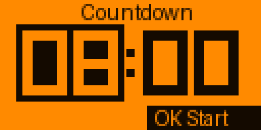
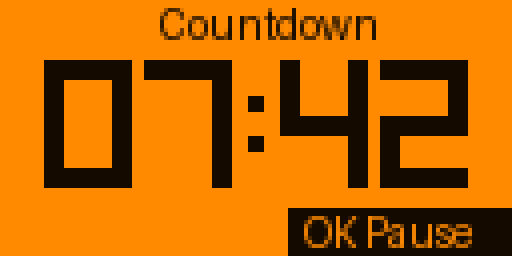
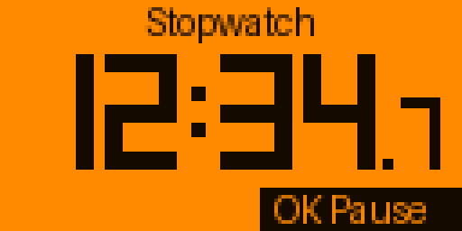
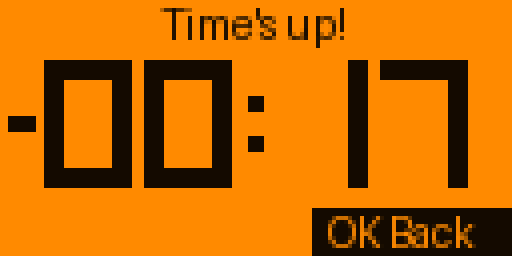
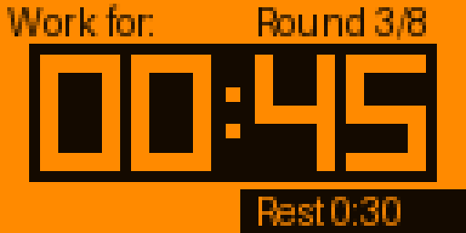
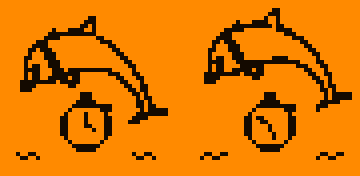

# Workout Timer for the Flipper Zero

A training app with a **Countdown / Stopwatch** and an **Interval Timer** (inspired by the Gymboss). The menu dolphin is original artwork and is animated.

## Features

| Menu entry | Description |
|---|---|
| **Countdown** | Minutes and seconds are set separately. At 00:00 it becomes the **Stopwatch** (counts up, with tenths of a second). |
| **Interval Timer** | Prep / Work / Rest and rounds (0 = endless). Work and Rest from 2 s to 99 min. |
| **Alert** | Vibration, Beep, Both or No (no vibration and no beep; the LED still flashes). |
| **Volume** | Three bars: no bar = Off, 1 = Low, 2 = Mid, 3 = Loud. |

Settings are saved to the SD card.

## Screens

Large seven-segment digits fill the display. The images below are illustrations of the layout.

| Countdown setup (active field is dark) | Countdown running |
|---|---|
|  |  |

| Stopwatch (tenths on the right) | Time's up (overtime with minus sign) |
|---|---|
|  |  |

| Interval Timer (paused = dark digits) |
|---|
|  |

## The dolphin

The dolphin lives in the main menu and swaps between two frames every 2 seconds.

## Controls

**Menu:** Up/Down select, OK opens. On "Alert" and "Volume", Left/Right (or OK) change the value and play a preview. Back exits the app.

**Countdown:** Left = minutes active, Right = seconds active (the active field is shown dark). Up = increase, Down = decrease (hold to speed up). Seconds roll over into the next minute. OK = start.
- **Expired:** the title changes to "Time's up!", the time keeps running with a **minus sign** (overtime up to 99:59) and the red LED blinks every second. OK or Back exits.
- **Set to 00:00 = Stopwatch:** title "Stopwatch", counts up to 99:59. Tenths of a second are shown to the right of the seconds. OK = pause/resume, Left = reset to 00:00.

**Interval Timer:** Up/Down choose a field, Left/Right change the value (short press = 1, hold to speed up), OK = start.
- Work and Rest: 2 seconds to 99 minutes (Rest 0 = no break).
- Rounds: 1 to 99, **0 = Endless**.
- Run screen: the phase at the top left, the round at the top right, the remaining time in large digits in the middle (dark while paused) and the next phase with its duration on the button at the bottom right.

**While running:** OK = pause/resume, Right = next phase (interval only), Left = restart the current phase, Back = cancel.

## LED

A short flash per phase: blue = Prep, green = Work, yellow = Rest, cyan = Done. In the last three seconds of the Countdown and the Interval Timer the LED flashes red. After the Countdown has expired it keeps blinking red every second.

## Building

- Run `ufbt` in the project folder to create `dist/interval_timer.fap`, or
- use GitHub Actions (`.github/workflows/build.yml`): the finished file is under *Actions -> run -> Artifacts*.

Copy the .fap to `SD Card/apps/Tools/`. Start it under **Apps -> Tools -> Workout Timer**.

## Files in the repository

`interval_timer.c`, `dolphin_frames.h` (menu dolphin frames), `application.fam`, `interval_timer.png` (app icon, required by the build), `images/` (pictures for this README) and `.github/workflows/build.yml`.
