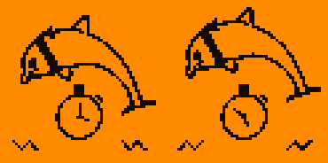
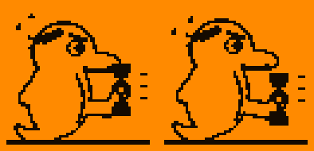
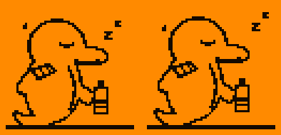

# Workout Timer für den Flipper Zero

Eine Trainings-App mit **Countdown / Stopwatch** und **Interval Timer** (nach dem Vorbild des Gymboss). Die Oberfläche ist komplett auf Englisch. Der Delfin ist eigene Grafik und wechselt in jedem Modus alle 2 Sekunden zwischen zwei Bildern.

## Funktionen

| Menüpunkt | Beschreibung |
|---|---|
| **Countdown** | Minuten und Sekunden getrennt einstellbar. Bei 00:00 wird daraus die **Stopwatch** (zählt hoch, mit Zehntelsekunden). |
| **Interval Timer** | Prep / Work / Rest, Runden (0 = endlos). Work und Rest von 2 s bis 99 min. |
| **Alert** | Vibration, Beep oder Both. |
| **Volume** | Drei Balken: kein Balken = Off, 1 = Low, 2 = Mid, 3 = Loud. |

Die Einstellungen werden auf der SD-Karte gespeichert.

## So sieht der Delfin aus (jeweils Bild A und B)

**Menü**

**Countdown / Stopwatch**

**Interval Timer: Work (Delfin trainiert)**

**Interval Timer: Rest (Delfin ruht sich aus)**

## Bedienung

**Menü:** Hoch/Runter wählen, OK öffnen. Bei „Alert" und „Volume" wechseln Links/Rechts (oder OK) den Wert und spielen ihn zur Probe ab. Zurück beendet die App.

**Countdown:** Links = Minuten aktiv, Rechts = Sekunden aktiv (das aktive Feld ist dunkel hinterlegt). Hoch = größer, Runter = kleiner (Halten beschleunigt). Die Sekunden laufen über 59 in die nächste Minute. OK = Start.
- **Abgelaufen:** Der Titel wechselt zu „Time's up!", die Zeit läuft mit **Minuszeichen** weiter (Überzeit bis 99:59) und die rote LED blinkt jede Sekunde. OK oder Zurück beendet.
- **00:00 eingestellt = Stopwatch:** Titel „Stopwatch", zählt bis 99:59 hoch. Die Zehntelsekunden stehen rechts neben den Sekunden. OK = Pause/Weiter, Links = zurück auf 00:00.

**Interval Timer:** Hoch/Runter Feld wählen, Links/Rechts Wert ändern (kurz = 1, Halten beschleunigt), OK = Start.
- Work und Rest: 2 Sekunden bis 99 Minuten (Rest 0 = keine Pause).
- Rounds: 1 bis 99, **0 = Endless**.
- Ansicht beim Ablauf: links der Delfin (trainiert bei Prep/Work, ruht bei Rest/Done), oben rechts die Phase, in der Mitte die Restzeit (dunkel hinterlegt, wenn pausiert), darunter die Runde, unten rechts die nächste Phase mit Dauer.

**Während des Ablaufs:** OK = Pause/Weiter, Rechts = nächste Phase (nur Intervall), Links = aktuelle Phase neu starten, Zurück = Abbruch.

## LED

Kurzes Aufblitzen je Phase: blau = Prep, grün = Work, gelb = Rest, türkis = Done. In den letzten drei Sekunden von Countdown und Interval Timer blitzt die LED rot. Nach Ablauf des Countdowns blinkt sie rot im Sekundentakt weiter.

## Bauen

- `ufbt` im Projektordner erzeugt `dist/interval_timer.fap`, oder
- per GitHub Actions (`.github/workflows/build.yml`): fertige Datei unter *Actions → Lauf → Artifacts*.

Die .fap nach `SD Card/apps/Tools/` kopieren. Start unter **Apps → Tools → Workout Timer**.

## Dateien im Repository

`interval_timer.c`, `dolphin_frames.h` (Delfin-Bilder), `application.fam`, `interval_timer.png` (App-Icon), `images/` (Bilder für diese README) und `.github/workflows/build.yml`.
